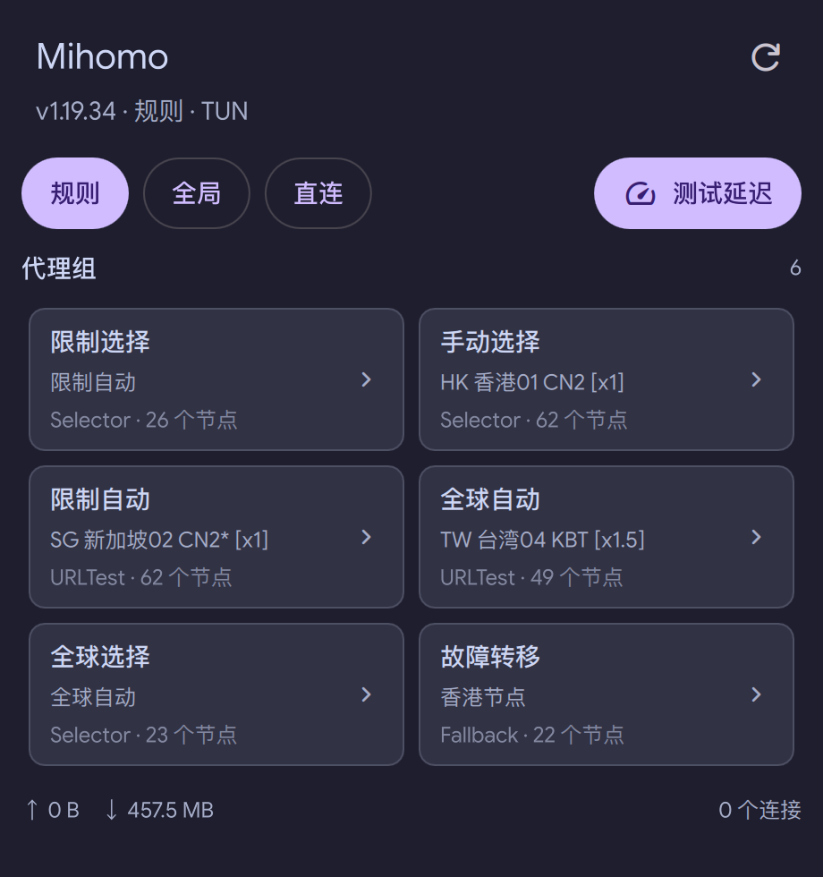

# Mihomo Indicator

A [DankMaterialShell](https://github.com/AvengeMedia/DankMaterialShell) bar widget for
[mihomo](https://github.com/MetaCubeX/mihomo). It reads your mihomo config, talks to the
external controller API, and shows live status in DankBar.




## Features

- Live upload/download speed in the bar
- Optional current node name in the bar
- Popout with:
  - rule / global / direct mode switching
  - proxy groups as two-column cards; click a card to pick a node
  - per-node latency badges and a group latency test
  - cumulative traffic and connection count
- Reads `external-controller` and `secret` from the mihomo config automatically
- Supports TCP controllers, IPv6, and `external-controller-unix` sockets
- English and Simplified Chinese UI

## Requirements

- DankMaterialShell 2.1 or newer
- `curl` on `PATH`
- mihomo with `external-controller` enabled, for example:

```yaml
external-controller: 127.0.0.1:9090
secret: ""
```

The config file must be readable by your user. If it is not, set the API address and
secret manually in the plugin settings.

## Install

```sh
git clone git@github.com:Nixie24/dux-plugin-mihomo-indicator.git \
  ~/.config/dms/plugins/mihomoIndicator
```

Or symlink a development checkout:

```sh
ln -s ~/Development/dux-plugin-mihomo-indicator ~/.config/dms/plugins/mihomoIndicator
```

Then open **Settings → Plugins**, enable **Mihomo Indicator**, and add it to the bar from
the bar's edit mode.

## Settings

| Setting | Default | Description |
| --- | --- | --- |
| Config file | `/etc/mihomo/config.yaml` | Read `external-controller` and `secret` from here |
| API address override | *(empty)* | Uses the config value when empty, e.g. `127.0.0.1:9090` |
| API secret override | *(empty)* | Uses the config value when empty |
| Refresh interval | `2s` | How often status and proxy groups are refreshed |
| Show traffic in the bar | on | Shows `↑ / ↓` speed next to the icon |
| Hide the leading icon | off | Shows only the traffic rates |
| Show selected proxy in the bar | off | Shows the active node name |
| Bar proxy group | *(empty)* | Group shown in the bar; empty picks `Final`, then the first visible Selector |
| Group visibility | `Show all groups` | Show all, hide selected, or show only selected; an empty "only" selection falls back to all |
| Latency test URL | `https://www.gstatic.com/generate_204` | URL used by the latency test |
| Icon size | `100%` | Icon scale relative to the bar |

## How it works

The widget uses these mihomo API endpoints:

- `GET /version`, `GET /configs` — version, mode, TUN state
- `GET /traffic` — kept open as a stream (one JSON line per second)
- `GET /proxies` — proxy groups, active node, latency history
- `GET /connections` — connection count while the popout is open
- `PUT /proxies/{group}` — select a node
- `PATCH /configs` — change the routing mode
- `GET /group/{group}/delay` — latency test

`/traffic` is a streaming endpoint, so the widget runs one long-lived `curl -sN` process
while the bar is visible instead of polling it.

The API secret is passed to `curl` as a command-line argument. It is visible in the local
process list while a request runs. Keep the controller bound to `127.0.0.1` as mihomo
recommends.

## Translations

Strings go through DMS's `I18n.trFor("mihomoIndicator", "Term")`, so the English term is the
source string. Translations live in `translations/<locale>.json` in the plugin format:

```json
{
  "Proxy groups": {
    "Proxy groups": "代理组"
  }
}
```

The directory currently ships `zh_CN.json`. Add another locale file (for example `de.json`)
to translate the plugin; DMS picks it up from the system locale automatically. There is no
`en.json` — untranslated terms fall back to the literal English text.

## License

MIT
